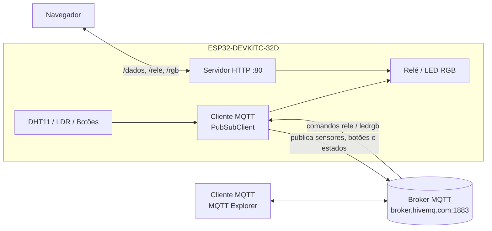

Estação de Monitoramento IoT com ESP32 (HTTP + MQTT)
Entrega 2 (N2) do trabalho de IoT. O projeto evolui a estação de monitoramento da Entrega 1, que funcionava apenas com um servidor HTTP local, para um sistema IoT com comunicação MQTT. Todas as funcionalidades da Entrega 1 foram mantidas.
Repositório: https://github.com/NFelipe01/estacao-monitoramento-esp32-mqtt
Autor: Nathan, Engenharia de Computação
---
Funcionalidades
Leitura de temperatura e umidade (DHT11) e de luminosidade (LDR).
Publicação periódica dos sensores via MQTT, a cada 5 segundos.
Publicação do estado dos botões SW1 a SW4, somente quando mudam (com debounce de 30 ms).
Recebimento de comandos MQTT para ligar e desligar o relé e para definir a cor do LED RGB.
Publicação do estado do relé e do LED com retain, para que qualquer cliente veja o estado atual ao se conectar.
Indicação de presença do dispositivo (`online`/`offline`) com Last Will.
Página Web da Entrega 1 mantida, com atualização automática a cada 2 segundos.
Sincronização nos dois sentidos: um comando enviado pela página aparece no MQTT, e um comando enviado pelo MQTT aparece na página.
Reconexão automática ao broker sem bloquear o servidor HTTP.
---
Arquitetura

O ESP32 conecta-se ao Wi-Fi e executa dois serviços em paralelo no `loop()`:
Servidor HTTP (Entrega 1): atende a página Web e as rotas de leitura e controle na rede local.
Cliente MQTT (Entrega 2): publica os dados no broker e recebe comandos de qualquer cliente conectado a ele, inclusive fora da rede local.
Os dois serviços usam as mesmas funções (`aplicarRele()` e `aplicarRGB()`) e as mesmas variáveis de estado. Por isso, uma alteração feita por um deles é refletida no outro.
---
Hardware
Placa: ESP32-DEVKITC-32D, com todas as chaves de SW5 em OFF e o jumper JP1 instalado para habilitar os botões.
Componente	Pino(s) do ESP32
DHT11	GPIO 33
LDR	GPIO 39
Botões SW1–SW4	GPIO 4, 0, 2, 15
Relé	GPIO 13
LED RGB (R/G/B)	GPIO 27, 26, 25
O LED RGB é de anodo comum, por isso o código inverte os valores de PWM (`255 - valor`).
---
Configuração do broker
Foi usado o broker público da HiveMQ, que não exige cadastro nem autenticação.
Parâmetro	Valor
Host	`broker.hivemq.com`
Porta	`1883` (TCP, sem TLS)
Autenticação	Nenhuma
Client ID	`esp32-nathan-<MAC da placa>`
Last Will	`satc/iot/nathan/status` = `offline` (retain)
Como o broker é público, todos os tópicos usam o prefixo único `satc/iot/nathan`, para não se misturarem com mensagens de outros usuários. Para usar outro prefixo, altere a linha `#define BASE` no código.
---
Estrutura dos tópicos
Prefixo: `satc/iot/nathan`
Publicados pelo ESP32
Tópico	Conteúdo	Frequência	Retain
`.../temperatura`	Temperatura em °C (ex.: `24.2`)	A cada 5 s	Não
`.../umidade`	Umidade em % (ex.: `62.0`)	A cada 5 s	Não
`.../luminosidade`	Luminosidade em % (0 a 100)	A cada 5 s	Não
`.../botao/1` a `/4`	`PRESSIONADO` ou `SOLTO`	Quando o estado muda	Não
`.../rele/estado`	`ON` ou `OFF`	Quando o estado muda	Sim
`.../ledrgb/estado`	`r,g,b` (ex.: `255,0,0`)	Quando o estado muda	Sim
`.../status`	`online` ou `offline`	Na conexão / Last Will	Sim
Comandos recebidos pelo ESP32
Tópico	Mensagem aceita	Efeito
`.../rele`	`ON` / `OFF` (também `1`/`0`, `LIGAR`/`DESLIGAR`)	Liga ou desliga o relé
`.../ledrgb`	`r,g,b` com valores de 0 a 255, ou `OFF`	Define a cor ou apaga o LED
A separação entre o tópico de comando (`rele`) e o de estado (`rele/estado`) faz com que o estado publicado reflita o que de fato aconteceu na placa, e não apenas o comando enviado.
---
Rotas HTTP (Entrega 1, mantidas)
Rota	Descrição
`/`	Página Web com sensores, botões, relé e LED RGB
`/dados`	JSON com todas as leituras e estados atuais
`/rele?estado=1|0`	Liga ou desliga o relé
`/rgb?r=&g=&b=`	Define a cor do LED RGB
---
Compilação e gravação
Requisitos
Arduino IDE 2.x
Pacote de placas esp32 da Espressif (Gerenciador de Placas)
Bibliotecas (Gerenciador de Bibliotecas):
PubSubClient, de Nick O'Leary
DHT sensor library, da Adafruit (instala junto a Adafruit Unified Sensor)
Passos
Clone o repositório ou baixe o .zip e abra o `.ino` na Arduino IDE. Se ela pedir para criar uma pasta com o nome do sketch, confirme.
Abra o `.ino` na Arduino IDE e informe a sua rede no início do código:
```cpp
   const char* ssid = "SUA_REDE";
   const char* password = "SUA_SENHA";
   ```
O ESP32 só se conecta a redes de 2,4 GHz.
Em Ferramentas → Placa, selecione ESP32 Dev Module e escolha a porta COM correta.
Clique em Upload (não use o botão Debug).
Observações sobre a gravação
Os botões SW2, SW3 e SW4 ficam nos GPIO 0, 2 e 15, que são pinos de boot do ESP32. Com o jumper JP1 instalado, eles podem impedir a entrada no modo de gravação. Retire o JP1 antes do upload e recoloque depois.
Se aparecer `Failed to connect to ESP32: No serial data received`, segure o botão BOOT quando surgir `Connecting...` e solte quando começar o `Writing at 0x...`.
Feche o Monitor Serial antes de gravar.
---
Execução e testes
Abra o Monitor Serial a 115200 baud e aperte EN. Devem aparecer a conexão Wi-Fi, o endereço IP, o início do servidor HTTP, a conexão ao broker e a mensagem `Sensores publicados via MQTT.` a cada 5 s.
Página Web: acesse o IP exibido, a partir de um dispositivo na mesma rede.
MQTT Explorer:
Crie uma conexão com host `broker.hivemq.com`, porta `1883`, sem TLS e sem usuário.
Em Advanced, remova os tópicos `#` e `$SYS/#` e adicione `satc/iot/nathan/#`, para exibir apenas os tópicos do projeto.
Conecte. A árvore `satc/iot/nathan` mostra os sensores, o status e os estados.
Envio de comandos (painel Publish do MQTT Explorer, formato raw, com retain desmarcado):
`satc/iot/nathan/rele` → `ON` ou `OFF`
`satc/iot/nathan/ledrgb` → `255,0,0`, `0,255,0`, `0,0,255` ou `OFF`
Sincronização: um comando pelo MQTT atualiza a página em até 2 s, e uma alteração pela página atualiza os tópicos de estado no broker.
Last Will: ao desconectar a placa, o tópico `status` muda para `offline` após alguns segundos.
---
Estrutura do repositório
```
estacao-monitoramento-esp32-mqtt/
├── estacao_monitoramento_esp32_mqtt.ino   # código-fonte completo (HTTP + MQTT)
└── Readme.md                              # este arquivo
```
